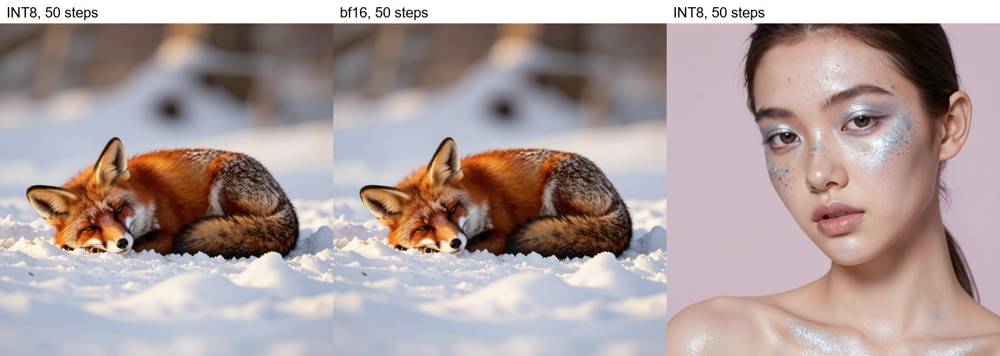
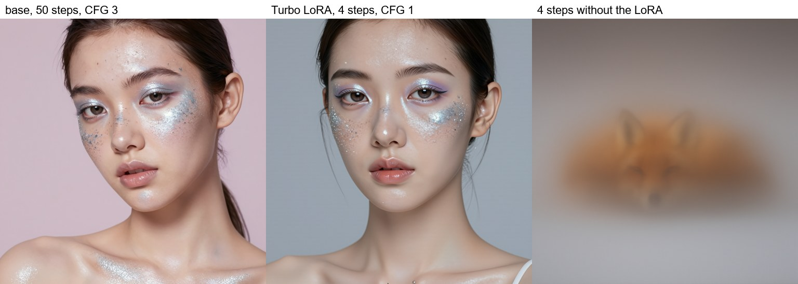
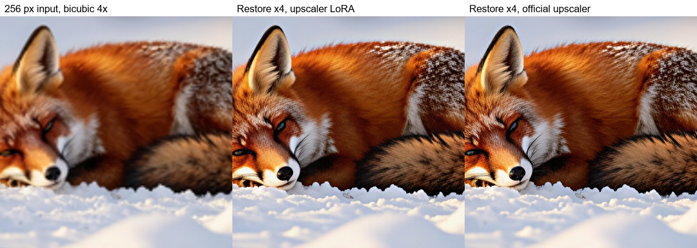
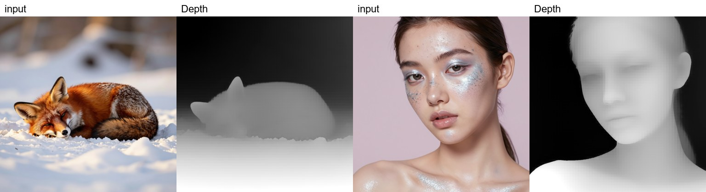

# 🖼️ Iris 3B for Forge Neo

> **Extension for [Stable Diffusion WebUI Forge - Neo](https://github.com/Haoming02/sd-webui-forge-classic/tree/neo)**

Generate with **[Iris 3B](https://huggingface.co/speridlabs/iris-3b)** inside Forge Neo, using the checkpoint, preset and Generate button you already know - an image model that paints every pixel directly, with no VAE, plus 4× image restoration, depth maps and 4-step turbo images, even on 8 GB GPUs.

> [!Important]
> This extension requires an up-to-date **Forge Neo** (the `neo` branch). On an older version it stays disabled and tells you so in the console - Forge Neo itself keeps working as usual.

---

## 📋 Table of Contents

- [What's New](#-whats-new)
- [Features](#-features)
- [Installation](#-installation)
- [Recommended Settings](#%EF%B8%8F-recommended-settings)
- [Tips](#-tips)
- [Credits](#-credits)

---

## 🆕 What's New

### v0.2.1 - Works Alongside Other Extensions

- **Plays well with other extensions** - the Forge check no longer breaks when another extension, such as MOSS-Image, loads first and hooks the loader.

### v0.2.0 - Restoration, Depth and Turbo

- **Restore x4** - a small or blurry picture restored and enlarged four times, in img2img.
- **Depth** - a depth map of any picture, in img2img.
- **Turbo LoRA** - a 1024x1024 image in 4 steps, with its own **Iris Turbo** schedule.
- **Iris DPM++ 2M** sampler - the sampler Iris was made with, now in the **iris** preset.
- **Older GPUs** - works on cards without bf16 (RTX 20xx), tested on an 8 GB RTX 2070.

### v0.1.0 - First Release

- **Iris 3B in Forge Neo** - checkpoint and text encoder load through the usual **VAE / Text Encoder** selector.
- **iris UI preset** - sampler, schedule, steps and CFG ready to generate.
- **Iris schedule** - the steps the model was trained on.

---

## 🎯 Features

> [!Tip]
> Every example below, in full resolution and with its prompt and settings, is in the **[wiki](https://github.com/eduardoabreu81/iris-3b-forge-neo/wiki)**.

### 🖼️ Native Generation

- Runs inside txt2img - no separate tab, no extra environment
- No VAE to choose: Iris paints the picture directly, and the live preview shows the real image as it forms
- Works with the Forge Neo model folders and the **VAE / Text Encoder** selector you already use
- Uses the same text encoder as Krea 2 - if you have Krea 2, you already have it
- Loads the bf16 and the lighter INT8 checkpoints - tested on an 8 GB RTX 2070

### ⚡ Turbo LoRA

- The **[Iris-3B Turbo LoRA](https://huggingface.co/pentacoxian-dev/iris-3b-turbo-lora)** makes a 1024x1024 image in 4 steps - about 4 seconds on an RTX 2070
- **Iris Turbo** schedule in the **Schedule type** list, made for it
- Works with the bf16 and INT8 checkpoints

### 🔍 Restore x4

- **Iris 3B** accordion in img2img → **Restore x4**
- Restores and enlarges the picture four times in a single pass - a few seconds
- Use the **[upscaler LoRA](https://huggingface.co/nynxz/iris-3b/tree/main/loras)** with your Iris checkpoint, or the official upscaler as the checkpoint - they give practically the same result
- Large pictures are handled in pieces and blended, with no seams

### 🌊 Depth

- **Iris 3B** accordion in img2img → **Depth**, with the Iris depth checkpoint
- A greyscale depth map of any picture, near is bright - ready for depth ControlNets
- Returned at the picture's own size

### 🔌 LoRA

- Iris LoRAs through Forge's usual `<lora:name:weight>` syntax
- Works with the bf16 and INT8 checkpoints alike, with **Patch LoRAs on-the-fly** on or off

### 🛡️ Safe by Design

- Changes no Forge Neo file - remove the extension and everything is as it was
- Checks your Forge Neo at startup and stays disabled if something it needs is missing
- Tells you what to change instead of making a wrong image - a depth checkpoint in txt2img, a setting Iris cannot use, a file made for another program
- Other models are not affected

---

## 📦 Installation

1. Open Forge Neo WebUI
2. Go to **Extensions** → **Install from URL**
3. Paste: `https://github.com/eduardoabreu81/iris-3b-forge-neo`
4. Click **Install** and restart the WebUI
5. Place your Iris files in the usual folders:

| Part | File | Folder |
| :--- | :--- | :--- |
| Iris checkpoint | [`iris-3b_bf16`](https://huggingface.co/nynxz/iris-3b) or the lighter `iris-3b_int8_convrot` | `models/Stable-diffusion` |
| Qwen3-VL 4B text encoder | [`qwen3vl_4b_bf16`](https://huggingface.co/Comfy-Org/Qwen3-VL/tree/main/text_encoders) or `qwen3vl_4b_fp8_scaled` | `models/text_encoder` |
| Turbo LoRA (optional) | [`r2-1000/student.safetensors`](https://huggingface.co/pentacoxian-dev/iris-3b-turbo-lora), renamed to `iris-3b-turbo_r2-1000` | `models/Lora` |
| Upscaler LoRA (optional) | [`iris-3b-upscaler_r128`](https://huggingface.co/nynxz/iris-3b/tree/main/loras) | `models/Lora` |
| Depth checkpoint (optional) | [`iris-3b-depth_bf16`](https://huggingface.co/nynxz/iris-3b) or `iris-3b-depth_int8_convrot` | `models/Stable-diffusion` |

6. Pick the **iris** UI preset, the checkpoint, and the text encoder under **VAE / Text Encoder**

---

## ⚙️ Recommended Settings

| Use | Sampler | Schedule type | Steps | CFG |
| :--- | :--- | :--- | :--- | :--- |
| **Images** | Iris DPM++ 2M | Iris | 50 (100 for the best quality) | 3 |
| **Turbo LoRA** at weight 1 | LCM | Iris Turbo | 4 | 1 |
| **Restore x4** and **Depth** | set by the extension | - | - | - |

Leave the **negative prompt** empty, and use about 1 megapixel with sides a multiple of 16: 1024x1024, 1152x896, 1280x832, 1344x768 or their portrait versions.

---

## 💡 Tips

- Keep **Settings** → **VAE** → **VAE for Decoding** and **VAE for Encoding** on *Full* - Iris has no VAE, and the extension tells you if they are changed
- Small sizes such as 512x512 show square blocks - stay near 1 megapixel
- **Hires. fix** is not supported yet - generate at the final size instead
- Prompts are read up to about 295 tokens; longer ones are cut
- For **Restore x4**, write only the LoRA in the prompt: `<lora:iris-3b-upscaler_r128:1>`; with the official upscaler as the checkpoint, leave the prompt empty
- **Restore x4** works best on pictures of 256 to 512 px; bigger ones take longer
- For **Depth**, enlarge pictures smaller than about 600 px first - small ones come out blocky
- The official upscaler and the depth checkpoints only work with **Restore x4** and **Depth** - they cannot make new pictures
- img2img variations come out sharper than the input even at low denoising; to enlarge or clean up a picture, use **Restore x4**
- The Turbo LoRA follows backgrounds and styles less closely than the full 50 steps - use the base settings for the final picture
- Before uninstalling, switch the UI preset to another one

---

## 📄 Credits

- **[Forge Neo](https://github.com/Haoming02/sd-webui-forge-classic/tree/neo)** by Haoming02
- **[Iris 3B](https://huggingface.co/speridlabs/iris-3b)** by Speridlabs - the model, its restoration and depth fine-tunes
- **[ComfyUI-Iris](https://github.com/envy-ai/ComfyUI-Iris)** by envy-ai - reference implementation of the model
- **[nynxz](https://huggingface.co/nynxz/iris-3b)** - the bf16, INT8 and depth checkpoints and the upscaler LoRA
- **[pentacoxian-dev](https://huggingface.co/pentacoxian-dev/iris-3b-turbo-lora)** - the Turbo LoRA

---

## 📜 License

AGPL-3.0 - see [LICENSE](LICENSE)

---

Made with ❤️ for the Stable Diffusion community

**[Report Bug](https://github.com/eduardoabreu81/iris-3b-forge-neo/issues)** • **[Request Feature](https://github.com/eduardoabreu81/iris-3b-forge-neo/issues)** • **[☕ Ko-fi](https://ko-fi.com/eduardoabreu81)**

